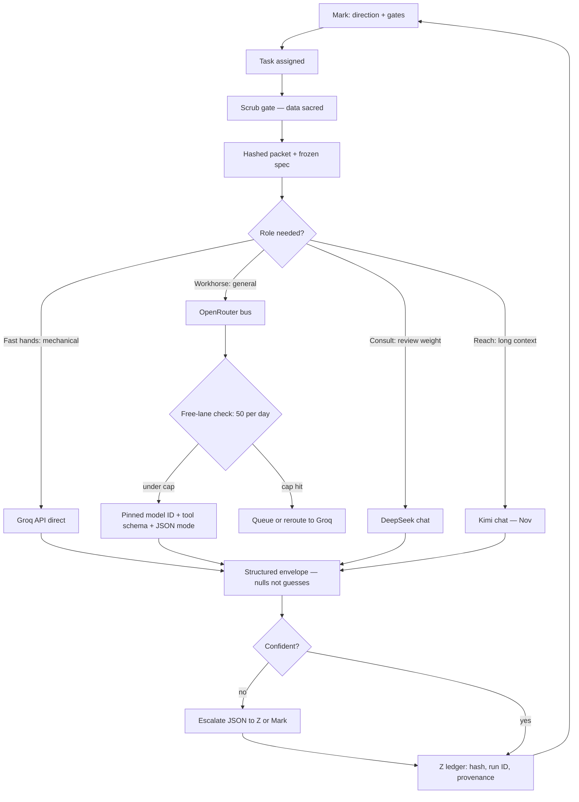

# Council / runtime-probe thread — archive sweep

Source: Z thread (historical-model council / managed-runtime-probe / night-builds session, ran ~2026-10-22), archived 2026-10-28 with Mark's authorization ("Amen to archive this"). Seat: Z (Vibe/Mistral). Companion residue packet: `inbox/2026-10-28-council-thread-residue-for-q.md`. This file = durable thread state. Repo-canonical code (runtime-probe PR #1 in lightbringers-castle; Meraki's merged council_batch.py in peanut-gallery) is NOT re-included — pointers only.

## Wrapper contract — ACCEPTED as integration base (Meraki's council_batch.py, merged)

- Statuses: {ok, error, timeout, stopped, unattempted}; deep-copied native record under `raw` (incl. diagnostics on success); null-filled metrics; serial, no-retry; STOP honored with unattempted tail; caught exceptions get a `wrapper_boundary` stage — NEVER `wrapper_preflight` (the wrapper can't know where inside the call the exception occurred; it only knows its own boundary).
- **Credit chain (deep-scan finding):** Q (spec) → Z (draft) → Meraki (correction + merge). Three seats, one artifact.
- **Origin of the boundary rule:** Z's draft carried stage `wrapper_preflight` — claiming to KNOW the failure happened before the call. Meraki's merged version corrected it to `wrapper_boundary`: the wrapper only ever knows its own boundary. The banked rule is a review-correction receipt, not a first draft.

## Codex night-build packet — delivered, frozen (canvas did not survive archive)

Four one-go prompts, branch `codex/night-2026-10-22`, one commit per task, never main, offline fixtures only, stdlib-first, evidence/ + REVIEW.md (5 morning-check items) each, stop-when-green. Order matters: run 1→4 — prompt 1 unblocks the most downstream work.

1. **MCP batch tool** (named pending integration item): `batch_call(calls_json, timeout=120)` in mcp_server.py — JSON array parse, structured error never exception, full envelope returned; tests via in-memory MCP client, monkeypatched fixtures. FROZEN acceptance: tool listed+callable through MCP layer; mixed ok/error/ok survives in order in one envelope; STOP = stopped row + unattempted tail, raw=null on wrapper rows; invalid JSON = structured error with error_type JSONDecodeError; existing 22 tests untouched.
2. **scrub.py** (the "data is sacred" doctrine as a tool): CLI `scrub.py IN OUT --report REPORT.json`; regex detections (sk-/sk-or-v1-/Bearer/PEM/AKIA keys, emails, IPv4, >32-char high-entropy, env assignments >8, /home/-//Users/ paths); redact to [SCRUBBED:type]; report lists type+line+redaction, ends with count; NEVER claims "clean" — absence = "no patterns matched." Acceptance: dirty fixtures all fire; clean fixture = zero findings stated exactly; idempotent (re-scrub changes nothing).
3. **ledger.py** (evidence doctrine as a tool): `add` appends {uuid4, UTC iso, type, payload_sha256, parsed payload}; `verify` recomputes every hash, per-line OK/BAD, exit 0 only all-good, first BAD names line + stops. Acceptance: 3 adds verify clean; tamper one payload byte → verify names the line; malformed line = own error type, never a crash; append-only, never rewrites.
4. **or_probe.py** (Groq-probe pattern adapted): env-only key (OPENROUTER_API_KEY, OR_MODELS); per-model 3 checks (tool_calling, json_discipline, determinism) each reported separately, errors preserved; exact model ID in every row; GET /api/v1/key usage check before calls; JSONL results + final sha256 for the ledger; `--self-test` = fake transport, no network. Acceptance: good/malformed/timeout fake-transport paths all covered; no test touches network; human-runnable later with real key.

## Carried open items (post-archive live queue)

- **Morning review:** Mark pastes 4× evidence + 4× REVIEW.md → Z reviews against the frozen acceptance criteria above (same method as wrapper/STOP reviews); merge ruling is Mark's on each. Stalled prompt = save partial output; that's a review finding, not a failed night.
- **Groq API probe:** Mark runs the script verbatim (below), exact console model IDs (GPT OSS 120B first, then 20B + Qwen 3.8 27B); Z grades the three output lines.
- **Mistral quota (human action):** support contact (help.mistral.ai/en/articles/347458) after talks checkpoint, or plan check at admin.mistral.ai/organization/billing. Unblocked sequence: deploy_workflow_deployment(name="historical-runtime-probe", repo=lightbringers-castle, revision=4e09e850569213fe69eebf9fa6a9a4a4fc5ac40d, build_directory="runtime-probe", dockerfile_path="Dockerfile", hardened=false) → wait_workflow_deployment_ready(900s) → execute_workflow("historical-runtime-probe-v1", probe_id=probe-fc388f0ade0142b2b34255adcd7f3516) → verify probe ID in result+events+logs.
- **OpenRouter:** Mark-side probe against any `:free` model (key in env var only). or_probe.py may exist after the night build — check the paste first.
- **Later:** MCP batch merge = named next integration; ALBERT→decoder chain smoke run optional; Kimi onboarding Nov; old MarkDude account recovery Nov; 100-input frontier-workflow goal (historical pool) upstream.

## Groq API probe script (run-verbatim deliverable, rescued from canvas)

Canvas draft used MODEL `llama-3.3-70b-versatile` ("swap if deprecated; probe records the name"); the standing plan superseded with GPT OSS 120B first, exact console IDs day-of.

```python
"""Groq tooling probe: function calling, JSON discipline, determinism.
Three separate checks; actual errors preserved; nothing installed."""
import json
import urllib.request

API_KEY = "PASTE_KEY_HERE"          # free key: console.groq.com/keys
URL = "https://api.groq.com/openai/v1/chat/completions"
MODEL = "llama-3.3-70b-versatile"   # swap if deprecated; probe records the name


def call(payload):
    req = urllib.request.Request(
        URL,
        data=json.dumps(payload).encode(),
        headers={"Authorization": f"Bearer {API_KEY}",
                 "Content-Type": "application/json"},
        method="POST")
    with urllib.request.urlopen(req, timeout=60) as r:
        return json.loads(r.read())


def check(name, fn):
    try:
        print(name, "→", json.dumps(fn(), ensure_ascii=False))
    except Exception as exc:
        print(name, "→ ERROR", type(exc).__name__, str(exc))


def tool_calling():
    tools = [{"type": "function", "function": {
        "name": "symbolic_insert",
        "description": "Insert a noun into a template at its {noun} placeholder.",
        "parameters": {"type": "object",
                       "properties": {"noun": {"type": "string"},
                                      "template": {"type": "string"}},
                       "required": ["noun", "template"]}}}]
    r = call({"model": MODEL, "messages": [
        {"role": "user",
         "content": "Insert the noun 'florb' into the template "
                     "'The astronaut put on his {noun}.' Use the tool."}],
        "tools": tools, "tool_choice": "auto"})
    msg = r["choices"][0]["message"]
    return {"tool_calls": msg.get("tool_calls"),
            "content_is_null": msg.get("content") in (None, "")}


def json_discipline():
    r = call({"model": MODEL, "messages": [
        {"role": "system",
         "content": "Output ONLY valid JSON matching: "
                     "{\"status\": string, \"rows\": array of "
                     "{\"model_id\": string, \"elapsed\": number|null}}."},
        {"role": "user",
         "content": "Normalize: a ran in 1.5s; b timed out; c ran in 0.2s."}],
        "temperature": 0})
    content = r["choices"][0]["message"]["content"]
    parsed = json.loads(content)            # raises if not strict JSON
    assert all(k in row for row in parsed["rows"] for k in ("model_id", "elapsed"))
    return {"parsed": parsed}


def determinism():
    payload = {"model": MODEL, "temperature": 0, "messages": [
        {"role": "user", "content": "List three JSON keys a provenance record needs."}]}
    a = json.dumps(call(payload)["choices"][0]["message"]["content"])
    b = json.dumps(call(payload)["choices"][0]["message"]["content"])
    return {"identical": a == b}


if __name__ == "__main__":
    check("tool_calling", tool_calling)
    check("json_discipline", json_discipline)
    check("determinism", determinism)
```

## Model-bus mermaid (team routing diagram, rescued from canvas)



Tags: #archive #council #runtime-probe #night-builds #Z
