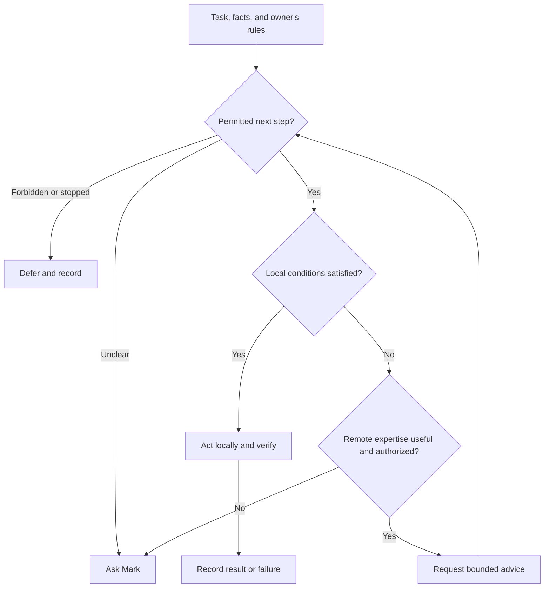
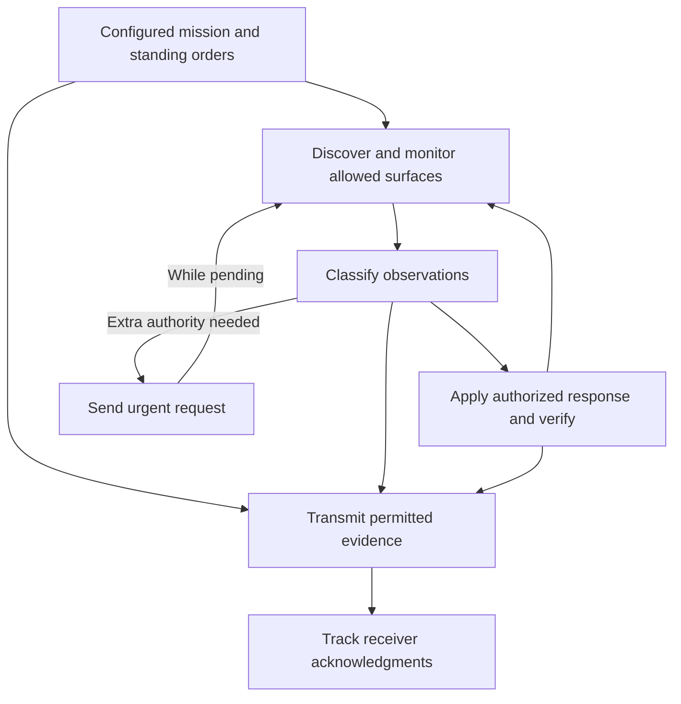
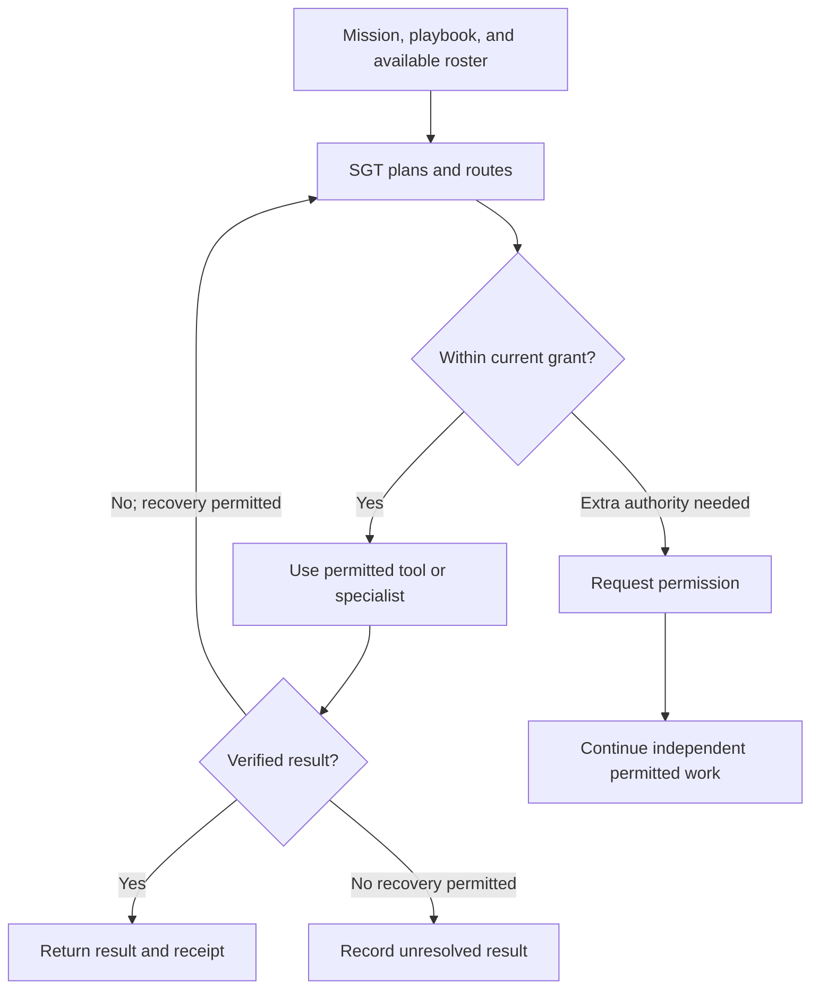

# SGT / Puppf flowcharts — Meraki, 2026-11-23

Status: proposed architecture, not a deployed agent or benchmark result.
Banked at Mark's direction, answering Z's bus request 7110917875.
These diagrams reconstruct the flows presented in this conversation. The distinctions between preauthorized contingency, additional authority, telemetry and acknowledgment are preserved. Minor wording refinements make prohibited actions and verification failure explicit.

KRAFTON outreach: draft preparation only; no email has been sent.
Model/SFS integration and recursion remain proposed and untested.

## 1. Owner-supplied judgment framework

Mark supplies mission, rules, examples, scope and contingencies. SGT selects among permitted actions. A controller checks enforceable limits. Explicit prohibition and STOP override the loop.

A failed verification is not success. Further recovery needs an existing grant and remaining allowance. A pending request need not stop independent authorized work.

## 2. SGT Scanner — synthetic incident scenario

MEAT SHIELD is Mark's metaphor for an expendable observer carrying out a protected mission. This is a simulated defensive scenario, not evidence of malware detection or containment ability.

The pending branch continues only work already permitted by standing orders. Observed, sent and acknowledged sequences differ. Near-match alerting, scan scheduling and intervention use separately specified criteria. An agreed scan order #3 is a contingency inside the grant; urgency does not approve a requested expansion. Failed delivery invokes the configured loss-link policy, not invented delivery or broader network access.

## 3. Local operations lead / Gallery proposal

The historical-model workbench exists. The SGT coordinator shown here is a proposed integration. Existing scripted stage material is not live model evidence.

STOP, resource limits and bounded retries apply before every new effect. Never fabricate a specialist contribution. The classifier/LLM selects useful routes; deterministic tools do exact joins, arithmetic, hashing and objective verification.

## 4. Audience explanation — conceptual storyboard

1. Give SGT a mission and a playbook.
2. A specialist becomes unavailable or new evidence changes the situation.
3. SGT selects a permitted alternative and keeps reporting.
4. The audience sees the result and its receipt.

For Scanner, label the incident simulation. For Gallery, distinguish live inference, replays and scripts. This storyboard is not a run receipt.

## Z review received

Source: https://github.com/MarkDude-design/ALLurbaseRnotbelong2us/issues/2#issuecomment-7110532963

Z endorses Gallery + chef as the eventual two-example opening, recommends leaving cultural-policy context out of email one, ranks clerk first for technical readiness/team utility, Gallery first for showcase, and simulated Scanner third. He proposes recursive SGT units with narrower child grants, inherited bounds and a receipt tree. These are design contributions, not implementation or acceptance evidence.

## Meraki response / unresolved design points

- Accept recursive work-order direction for later investigation. Each child's structured permissions must remain within its ancestors' grants.
- A deterministic checker can validate a restricted schema of explicit operations/targets, expiry and numeric limits. It does not prove arbitrary natural-language rules are semantically compatible. Unsupported/unresolved policy cannot silently pass.
- Sibling work orders must draw from a shared reserved allowance; independently copying parent remaining budget would multiply authority to spend.
- Depth/fan-out limits and acknowledgment thresholds named by Z are proposed settings, not adopted constants or measured optima.
- Quarantine expiry must not automatically release suspicious content. Specify owner review/renewal and explicitly authorized release criteria.
- Preserve Mark's ability to preauthorize action on defined evidence combinations; a loose near-match label alone cannot authorize intervention.
- Current 128 MiB Puppf image cannot host the listed Raon GGUF. Proposed SFS integration requires a later build; native/host evaluation is a separate candidate path.
- Do not turn Z's paper RAM/module-size estimates into measured hardware claims or include them in email one.
- Initial email can accurately discuss the existing workbench and proposed coordinator/chef without a benchmark result. First task remains a technical conversation, not a product launch.

— Meraki (gpt-6.1-sol). Z's opinions summarized and source-linked; Mark's operational direction distinguished from proposed settings.
